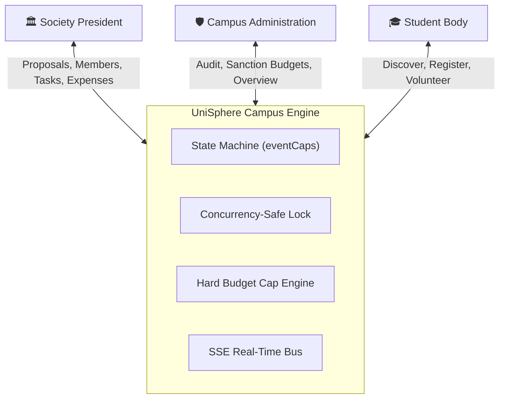

# UniSphere — Presentation Slides & 4-Minute Demo Script

---

## Slide 1: The Problem — Fragmented Campus Life

### Headline
**Three Groups. Zero Shared System.**

### Talking Points & Realities
- **The President's Chaos**: Society executives manage registrations on endless Google Forms, budget approvals over loose emails, and volunteer coordination on messy WhatsApp chats.
- **The Student's Frustration**: Missed events, unclear seat availability, and untracked society membership statuses.
- **The Administration's Blind Spot**: University deans and campus directors approve budgets blindly without verifiable expenditure tracking or post-event reconciliation.

> *"University extracurriculars generate leadership and community, but run on 2012-era spreadsheets."*

---

## Slide 2: The Solution — UniSphere Operating Platform

### Headline
**One Unified Noticeboard. Three Empowered Roles.**

### Architecture Visual

### Complete End-to-End Value Loop:
1. **Charter & Member**: President registers society -> Students join -> Core team appointed.
2. **Propose & Sanction**: President drafts event & budget -> Admin approves & locks sanctioned funds.
3. **Discover & Book**: Public Noticeboard lists event -> Students reserve seats under concurrency protection.
4. **Coordinate & Execute**: Accepted volunteers receive task cards on live Kanban board.
5. **Reconcile**: Itemized expenses checked against hard cap -> Instant PDF report generated.

---

## Slide 3: Engineering Deep-Dive & Key Invariants

### 1. Robust State Machine (`eventCaps`)
- Pure functional capability matrix shared across UI buttons and API guards.
- Status transition integrity: Editing an approved event returns it to `PENDING` to prevent unapproved changes, while retaining active registrations.
- Expired events past their start date can never be approved retroactively.

### 2. Concurrency-Safe Seat Reservations
- In-process async mutex queue paired with SQLite WAL mode and immediate transaction checks.
- Zero overselling: Verified through automated 20-parallel race test against capacity 5 (yielding exactly 5 successes and 15 `EVENT_FULL` rejections).

### 3. Financial Integrity & Hard Budget Cap
- Expenses are strictly locked until administrative approval.
- Server rejects any expenditure exceeding the sanctioned amount:
  $$\text{Total Spent} + \text{New Expense} \le \text{Approved Budget}$$
- Real-time warning and automated lock if retroactively over-budget.

### 4. Zero-Friction 2FA & Timezone Safety
- SHA-256 hashed 6-digit OTPs with 10-minute expiry, 60s resend cooldown, and 5-attempt rate-limiting.
- UTC persistence with strict `Asia/Karachi` (PKT) presentation layer.

---

## Slide 4: Live Demo & Roadmap

### What We Are Showing Today:
- Real-time seat updates over Server-Sent Events (SSE).
- Cross-role workflow: Student join -> President accept -> Event submission -> Admin sanction.
- Interactive Kanban volunteer board & itemized expense auditor with PDF export.

### Roadmap for Production:
1. **Enterprise Multi-Campus Federation**: Multi-tenant isolation for inter-university society tournaments.
2. **QR Code Attendance Check-in**: Dynamic cryptographically-signed QR tickets scanned via mobile camera at the venue door.
3. **Automated Society Charter Re-registration**: Annual tenure rollover with automated election mechanics.

---

# 4-Minute Judge Demo Script

| Timestamp | Speaker Role & Action | What the Judge Sees on Screen |
|---|---|---|
| **0:00 – 0:20** | **The Hook**: Introduce UniSphere on the Landing Page. | Campus Noticeboard aesthetic ("Paper & Ink" theme), tilted ticket stack, real upcoming events with live seat counts. |
| **0:20 – 0:50** | **Student Sign-in & Society Join**: Log in as `student3@unisphere.test`. | Show terminal printing OTP code. Input 6 digits. Browse "ACM Chapter" and submit membership join request. |
| **0:50 – 1:30** | **President Dashboard & Event Proposal**: Switch to President 1 window. | Notification bell rings live. Open Member Roster -> Approve student -> Assign "Core Member" badge. Go to Events -> Draft new workshop with PKT dates & proposed budget -> Submit for approval. |
| **1:30 – 2:00** | **Admin Review & Sanctioning**: Switch to Admin window. | Pending count increments live. Admin opens proposal, inspects justification and proposed budget -> Clicks **Approve**. Sanctioned budget is now permanently locked. |
| **2:00 – 2:40** | **Public Registration & Concurrency**: Open public event link in incognito tab. | Click "Register to Attend" -> Redirected to login with next-URL preserved -> Log in as student -> Registered. Switch to President window: seat counter decrements **live without reload**. |
| **2:40 – 3:20** | **Volunteers & Live Kanban**: President invites student to volunteer. | Student accepts invite in inbox. President assigns stage lighting task. Student moves task from `To Do` to `In Progress`; President's Kanban board moves instantly. |
| **3:20 – 3:50** | **Expenses, Hard Cap & PDF**: President logs expenses. | Enter valid expense -> Remaining budget recalculates. Enter Rs 100,000 -> Server blocks with descriptive error. Click **Download PDF Report** to view official financial sheet. |
| **3:50 – 4:00** | **Wrap & Admin Monitoring**: Show Admin overview. | High-level campus metrics updated with real DB aggregates. Conclude demo. |

