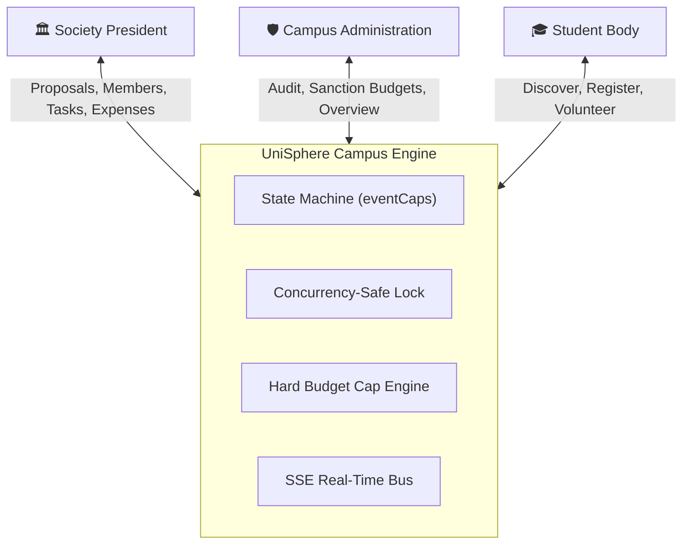

# UniSphere — Presentation Slides & 4-Minute Demo Script

---

## Slide 1: The Problem — Fragmented Campus Life

### Headline
**Three Groups. Zero Shared System.**

### Talking Points & Realities
- **The President's Chaos**: Society executives manage registrations on endless Google Forms, budget approvals over loose emails, and volunteer coordination on messy WhatsApp chats.
- **The Student's Frustration**: Missed events, unclear seat availability, and untracked society membership statuses.
- **The Administration's Blind Spot**: University deans and campus directors approve budgets blindly without verifiable expenditure tracking or post-event reconciliation.

> *"University extracurriculars generate leadership and community, but run on 2012-era spreadsheets."*

---

## Slide 2: The Solution — UniSphere Operating Platform

### Headline
**One Unified Noticeboard. Three Empowered Roles.**

### Architecture Visual

### Complete End-to-End Value Loop:
1. **Charter & Member**: President registers society -> Students join -> Core team appointed.
2. **Propose & Sanction**: President drafts event & budget -> Admin approves & locks sanctioned funds.
3. **Discover & Book**: Public Noticeboard lists event -> Students reserve seats under concurrency protection.
4. **Coordinate & Execute**: Accepted volunteers receive task cards on live Kanban board.
5. **Reconcile**: Itemized expenses checked against hard cap -> Instant PDF report generated.

---

## Slide 3: Engineering Deep-Dive & Key Invariants

### 1. Robust State Machine (`eventCaps`)
- Pure functional capability matrix shared across UI buttons and API guards.
- Status transition integrity: Editing an approved event returns it to `PENDING` to prevent unapproved changes, while retaining active registrations.
- Expired events past their start date can never be approved retroactively.

### 2. Concurrency-Safe Seat Reservations
- In-process async mutex queue paired with SQLite WAL mode and immediate transaction checks.
- Zero overselling: Verified through automated 20-parallel race test against capacity 5 (yielding exactly 5 successes and 15 `EVENT_FULL` rejections).

### 3. Financial Integrity & Hard Budget Cap
- Expenses are strictly locked until administrative approval.
- Server rejects any expenditure exceeding the sanctioned amount:
  $$\text{Total Spent} + \text{New Expense} \le \text{Approved Budget}$$
- Real-time warning and automated lock if retroactively over-budget.

### 4. Zero-Friction 2FA & Timezone Safety
- SHA-256 hashed 6-digit OTPs with 10-minute expiry, 60s resend cooldown, and 5-attempt rate-limiting.
- UTC persistence with strict `Asia/Karachi` (PKT) presentation layer.

---

## Slide 4: Live Demo & Roadmap

### What We Are Showing Today:
- Real-time seat updates over Server-Sent Events (SSE).
- Cross-role workflow: Student join -> President accept -> Event submission -> Admin sanction.
- Interactive Kanban volunteer board & itemized expense auditor with PDF export.

### Roadmap for Production:
1. **Enterprise Multi-Campus Federation**: Multi-tenant isolation for inter-university society tournaments.
2. **QR Code Attendance Check-in**: Dynamic cryptographically-signed QR tickets scanned via mobile camera at the venue door.
3. **Automated Society Charter Re-registration**: Annual tenure rollover with automated election mechanics.

---

## Slide 5: Task 2 — Mega Event Management & Multi-Track Coordination

### Headline
**From Single Events to Multi-Day Campus Festivals.**

### Architectural Invariants:
1. **Multi-Track Decentralization**:
   - Mega Events host multiple sub-events spanning consecutive festival days.
   - Student Supervisors are appointed per sub-event with dynamic DB permissions — **no new database roles required**.
   - Immediate privilege revocation on supervisor reassignment (0 cache latency).
2. **Strict Financial Isolation & 80% Alert Rule**:
   - Budget allocations are committed **once per sub-event** under PostgreSQL row locks (`SELECT FOR UPDATE`).
   - Hard festival limit: Sum of sub-event allocations $\le$ Mega Event budget cap.
   - Concurrency-safe integer spending: crossing $\ge 80\%$ triggers exactly **one notification** to the president with atomic `budgetAlertSent = true` flag.
   - Supervisors and outsiders operate on sanitized DTOs with **zero budget visibility**.
3. **Zero Regression Guarantee**:
   - Task 1 public listings, landing page queries, and admin approval queues are completely untouched and isolated.
   - Task 1 tests (`test:rubric`) and Task 2 tests (`test:task2`) pass at 100% concurrently.
4. **AI Operations & Health Telemetry**:
   - Generates verified executive summaries, observations, and bottleneck alerts strictly grounded in authoritative DB metrics.

---

# 4-Minute Judge Demo Script (Including Task 2)

| Timestamp | Speaker Role & Action | What the Judge Sees on Screen |
|---|---|---|
| **0:00 – 0:25** | **Admin: Mega Event Creation**: Log in as `ahmadcode24@gmail.com` -> Navigate to **Mega Events** -> Click "Create Mega Event". | Input title "NEXUS Tech Fest 2026", select NEXUS Society, festival dates, and Rs 150,000 budget cap. President `nexus.president` auto-assigned. |
| **0:25 – 1:00** | **President: Sub-events & Checklist**: Switch to `nexus.president@unisphere.test`. | Open Mega Event -> Create "Gaming Competition" & "Web Dev Workshop" with PKT times -> Assign student supervisor -> Add checklist tasks without requiring society membership. |
| **1:00 – 1:20** | **Student Supervisor: Decentralized Execution**: Log in as `nexus.student1@unisphere.test`. | View "My Supervised Sub-events" with live % progress bar -> Open checklist -> Mark task "Completed" -> **Confirm zero budget figures visible anywhere**. |
| **1:20 – 1:40** | **President: Budget Allocation & 80% Alert**: Switch back to President window -> Budget tab. | Allocate Rs 50,000 cap -> Attempt over-allocation (blocked) -> Record Rs 40,000 expense (80%) -> **Bell notification rings with 80% alert badge**. |
| **1:40 – 2:00** | **AI Operations Report**: President clicks "Analyse with AI". | Instant executive health report generated with verified metrics table, observations, and bottleneck recommendations. |
| **2:00 – 2:40** | **Task 1 Cross-Verification & Public Isolation**: Open `/events` and landing page. | Confirm Task 1 events are live while Mega Events remain strictly internal and isolated. Show student event registration. |
| **2:40 – 3:20** | **Volunteers & Live Kanban**: President invites student to regular event. | Student accepts invite in inbox. President assigns task; Kanban moves in real time across screens. |
| **3:20 – 3:50** | **Expenses, Hard Cap & PDF**: President logs event expense. | Attempt over-budget expense -> Server blocks with descriptive error. Click **Download PDF Report** to view official financial sheet. |
| **3:50 – 4:00** | **Wrap & Architecture Review**: Show Admin telemetry. | Conclude demo: "UniSphere delivers bulletproof state machines, zero regressions, and full campus governance." |

